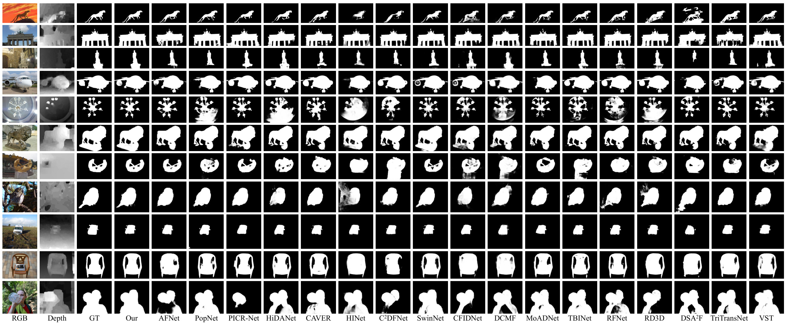
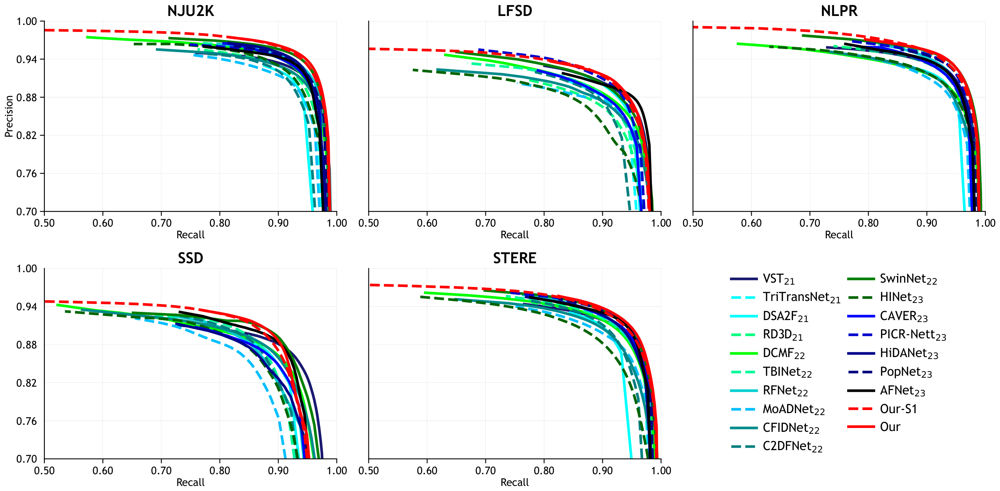

# EATNet

**EATNet: Edge-Aware and Transformer-Based Network for RGB-D Salient Object Detection**

Xu Liu, Chenhua Liu, Xianye Zhou, and Guodong Fan · *Multimedia Systems*, 2025. [Paper](https://doi.org/10.1007/s00530-025-01717-5)

## Overview

EATNet predicts a pixel-level saliency map from a paired RGB image and depth map. A dual-stream Swin Transformer extracts multi-scale features from both modalities. The cross-modal feature enhancement and fusion module (CFEM) combines complementary RGB and depth cues. The edge-aware module (EAM) predicts salient-object boundaries, which guide the decoder as it aggregates features across scales and produces the final saliency map.

## Comparison with Existing Methods

### Qualitative Comparison



*Figure 1. Example RGB-D inputs, ground-truth masks (GT), and saliency predictions. The column labeled “Our” shows EATNet predictions.*

### Precision–Recall Curves



*Figure 2. Precision–recall curves on five RGB-D benchmarks. The solid red curve labeled “Our” denotes EATNet.*

## Downloads

### Model Checkpoints

- [Baidu Netdisk](https://pan.baidu.com/s/140fPKsnqNn3l7edHg8uY3A?pwd=dcf9) (extraction code `dcf9`)

### EATNet Saliency Maps

- [Baidu Netdisk](https://pan.baidu.com/s/1HxMjuCgSn4j57jXzgjz85w?pwd=htar) (extraction code `htar`)

### Saliency Maps from All Compared Models

- [Baidu Netdisk](https://pan.baidu.com/s/18rbe21QJuwC7dNMXl2htKg?pwd=w4t8) (extraction code `w4t8`)

## Citation

```bibtex
@article{liu2025eatnet,
  author  = {Liu, Xu and Liu, Chenhua and Zhou, Xianye and Fan, Guodong},
  title   = {{EATNet}: edge-aware and transformer-based network for {RGB-D} salient object detection},
  journal = {Multimedia Systems},
  year    = {2025},
  volume  = {31},
  number  = {2},
  pages   = {128},
  doi     = {10.1007/s00530-025-01717-5}
}
```

## License

The code is released under the [Apache License 2.0](LICENSE).
